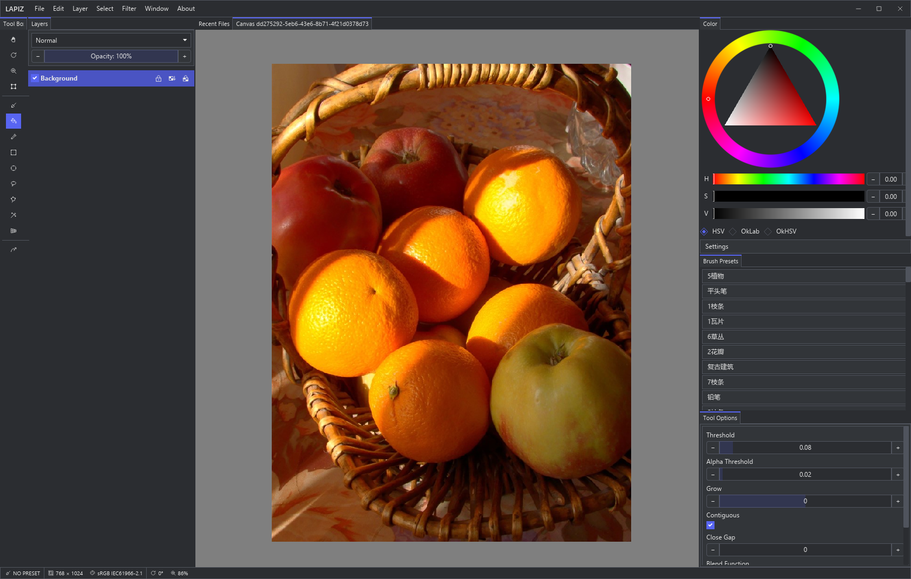

# Lapiz

_Project logo under construction_

> [!WARNING]
> This project is still at pre-pre-pre-alpha stage, and is absolutely not intended for production use. It has tons of bugs and incomplete code!

> Cute orange photo by Dariusz Duchiewicz on [Pexels](https://www.pexels.com/photo/bright-basket-of-oranges-and-apples-36492525/)

A GPU powered, programmable, highly customizable and blazing fast digital painting program written in Rust, build with ❤ and passion, and open-source forever under the GPL-3.0-or-later License.

The name "Lapiz" means pencil in Spanish. It looks like the English word "Lapis", which is a kind of blue, natural blue mineral and one of the oldest and most precious blue pigments. About the pronounciation, neither English nor Spanish is my native language, so it pronounces whatever you like.

## Development

Lapiz uses [just](https://just.systems/) for all commands.

### Build

`just setup` then `just run dev-local`. That's it. Use `just --usage <recipe>` for detailed help for a specific command and use `just` to have a overall usage view.

## LLM Assisted Contributions

This project is accepting LLM assisted contributions. BUT will absolutely reject any code that is not **reviewed by human**.

## Special Thanks

- [Bevy](https://bevy.org/)
- [Blender](https://www.blender.org/)
- [Krita](https://krita.org/)
- [LINUX DO](https://linux.do/)
- [Zed](https://zed.dev/)

## License

This project is licensed under the GPL-3.0-or-later License. See [LICENSE](LICENSE) for details.
